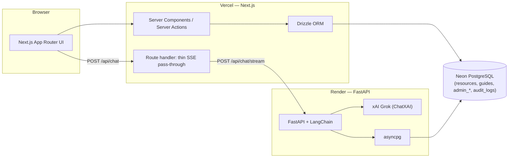

# Digital Wellness Resource Hub

An AI-powered platform that helps university students discover, compare, and configure
digital wellness tools — for screen time, doomscrolling, sleep, focus, notification overload,
and online privacy. Built as a production-shaped academic software engineering project.


---

## Problem statement

Most "digital wellness" tool roundups either list apps with no explanation of trade-offs, or
push a single paid product. Students are left to guess whether a tool actually works on their
phone, whether "free" really means free, and what a tool's privacy model actually is. This
project answers those questions directly, for exactly ten independently verified resources,
through a website, a guided assessment, a comparison table, and an AI chatbot — all reading
from the same database.

## Features

- **Interactive wellness assessment** — pick a problem, optionally a device and budget, get
  2–3 explained, honestly-caveated recommendations.
- **Resource discovery & comparison** — searchable, filterable catalog and a sortable
  comparison matrix covering all ten resources.
- **Three step-by-step setup guides** — screen time, bedtime routine, and tracker/website
  blocking, each with real troubleshooting notes (including a current, dated platform change:
  uBlock Origin's removal from the Chrome Web Store).
- **AI Digital Wellness Co-Pilot** — a streaming chatbot (FastAPI + LangChain + xAI Grok) that
  recommends only from the same ten-resource catalog the rest of the site uses.
- **Three themes** — Purple Midnight (default), Sanctuary, and Warm Minimalist, built on
  Tailwind v4's CSS-first token system, persisted per browser.
- **Private, secure admin dashboard** — resource/guide management, source verification,
  audit history, Argon2id-hashed passwords, server-verified sessions. No public admin link
  anywhere in the app.
- **Full accessibility & responsive design** — WCAG 2.2 AA target, tested at mobile/tablet/
  desktop breakpoints with Playwright.

## Technology stack

| Layer | Technology |
|---|---|
| Frontend | Next.js 16 (App Router), React 19, TypeScript (strict) |
| Styling | Tailwind CSS v4 (CSS-first, no `tailwind.config.js`), shadcn/ui-style + Radix UI primitives |
| Animation | Framer Motion |
| Icons | Lucide React |
| Validation | Zod (frontend), Pydantic (backend) |
| Backend | Python 3.12 FastAPI |
| AI orchestration | LangChain + `langchain-xai` (Grok) |
| Database | Neon Serverless PostgreSQL |
| ORM | Drizzle ORM + Drizzle Kit |
| Auth | Argon2id hashing (`@node-rs/argon2`), server-side sessions, HttpOnly cookies |
| Testing | Vitest + Testing Library, Playwright, Pytest |
| Deployment | Vercel (frontend), Render (backend), Neon (database) |

### Architecture



The frontend and the backend read the **same** `resources` table in Neon — there is exactly
one resource catalog in the whole system (`src/data/resources.ts` is the canonical content,
loaded into Postgres by the seed script; the FastAPI backend queries Postgres directly, never
a hardcoded copy).

## Project structure

```
digital-wellness-hub/
├── src/
│   ├── app/                 # Next.js App Router routes
│   ├── components/          # UI, layout, chatbot, admin, settings components
│   ├── data/                 # Canonical resource & guide content (source of truth)
│   ├── db/                   # Drizzle schema, client, seed script
│   ├── lib/                  # Recommendation engine, auth, utils
│   └── proxy.ts               # Next.js 16 proxy (lightweight admin redirect UX)
├── backend/
│   └── app/                  # FastAPI app (api/, ai/, services/, schemas/, core/)
├── drizzle/                  # Generated SQL migrations
├── docs/                     # Academic submission documentation (see below)
├── tests/                    # Vitest unit tests + Playwright e2e tests
└── backend/tests/            # Pytest backend tests
```

## Installation

### Prerequisites

- Node.js ≥ 20.9
- Python ≥ 3.12
- A [Neon](https://neon.tech) account (free tier is sufficient)
- An [xAI](https://console.x.ai) API key for Grok (see the note in
  `backend/app/ai/model.py` if you intended Groq-hosted `gpt-oss-120b` instead — the project
  brief named both, which are two different providers)

### 1. Clone and install the frontend

```bash
git clone <your-fork-url>
cd digital-wellness-hub
npm install
cp .env.example .env.local
# edit .env.local with your real DATABASE_URL, FASTAPI_BACKEND_URL, ADMIN_INITIAL_SETUP_SECRET
```

### 2. Set up the Neon database

Create a project at neon.tech, copy its **pooled** connection string into `DATABASE_URL` in
both `.env.local` (frontend) and `backend/.env` (backend) — both sides read the same database.

```bash
npm run db:generate   # generate SQL migrations from src/db/schema.ts
npm run db:migrate    # apply them to Neon
npm run db:seed       # idempotently load the ten resources + three guides
```

### 3. Set up the FastAPI backend

```bash
cd backend
python3 -m venv .venv && source .venv/bin/activate
pip install -r requirements.txt
cp .env.example .env
# edit backend/.env with your real XAI_API_KEY and DATABASE_URL
uvicorn app.main:app --reload --port 8000
```

### 4. Run the frontend

```bash
# from the project root, in a separate terminal
npm run dev
```

Visit `http://localhost:3000`.

### 5. Create the first administrator

Visit `http://localhost:3000/admin` (never linked from the public UI — go there directly).
Since no administrator exists yet, you'll see the one-time setup form. Enter the
`ADMIN_INITIAL_SETUP_SECRET` from your `.env.local`, an email, and a password (12+ characters).
This form permanently disables itself after the first account is created.

## Resource seeding

`npm run db:seed` is idempotent — it upserts by each resource's stable `id`, so running it
repeatedly never creates duplicates, and it verifies exactly ten resources exist afterward
(exiting non-zero otherwise). The canonical content lives in `src/data/resources.ts` — edit
there, then re-run the seed script, rather than editing Neon rows by hand.

## AI / Grok configuration

Set `XAI_API_KEY` and `XAI_MODEL` (default: `openai/gpt-oss-120b`) in `backend/.env`. **Read the comment
at the top of `backend/app/ai/model.py`** — the original project brief names both "Grok
through ChatXAI" and a model called `gpt-oss-120b`, which are two different AI providers
(xAI vs. Groq). The backend ships wired to real xAI Grok models by default so it works out of
the box; switching providers is a documented, three-line change in that one file.

## Testing

```bash
# Frontend unit tests
npm run test

# Backend tests (from backend/, with the venv active)
pytest

# End-to-end tests (requires the app built & both servers running, or let
# Playwright's webServer config start them — see playwright.config.ts)
npm run test:e2e
```

See [`docs/TESTING_AND_QA.md`](./docs/TESTING_AND_QA.md) for what has and has not actually
been executed, and why.

## Deployment

See [`DEPLOYMENT_GUIDE_VERCEL_RENDER.md`](./DEPLOYMENT_GUIDE_VERCEL_RENDER.md) for the full,
step-by-step walkthrough covering Vercel, Render, and Neon.

## Security considerations

- Passwords are hashed with Argon2id (`@node-rs/argon2`) — never stored in plaintext.
- Admin sessions are opaque random tokens; only a SHA-256 hash of the token is stored server-side.
- Every admin route and every sensitive server action re-verifies the session against the
  database — `src/proxy.ts` only provides a redirect for UX and is never trusted as the real
  authorization boundary (this is documented explicitly in both files).
- Login attempts are rate-limited per IP+email pair (5 failed attempts / 15 minutes).
- The chat endpoint is rate-limited per IP (`slowapi`) and validates message/history length.
- The Grok API key lives only in the FastAPI backend's environment — never sent to, or
  reachable from, the browser.
- CORS on the FastAPI backend is restricted to the single configured frontend origin.
- The backend never returns raw exception details or stack traces to clients.

## Future improvements

- Vector-based retrieval if the catalog grows beyond a size that fits comfortably in a system prompt.
- Real screenshots for the setup guides (current guides use described steps; see
  `docs/SETUP_GUIDES.md` for the policy on this).
- A proper admin UI for adding an 11th-then-removing-one-to-stay-at-ten resource swap workflow,
  rather than relying on an administrator to do that manually today.
- Automated nightly re-verification checks against each resource's official pricing page.

## License

MIT — see [`LICENSE`](./LICENSE). This is an academic project; verify current pricing and
platform support against each resource's own official site before relying on this catalog.
